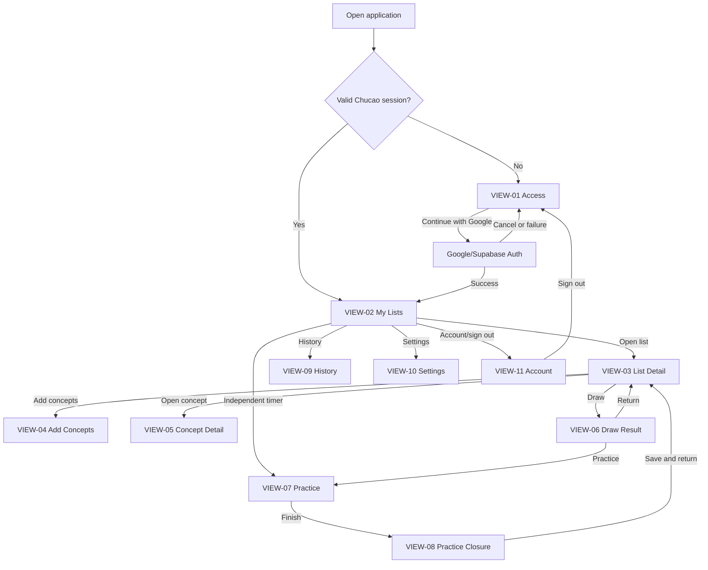

# Chucao Web — Application Flow

## 1. Status, scope, and references

**Status:** Complete flow draft, awaiting product review  
**Date:** 2026-11-16  
**Scope:** General navigation, main user journeys, observable states, transitions, and recovery behavior for the MVP and explicitly described later flows.

**Definition state:** Requirements from the global plan are marked **confirmed**. Additions from `temp/flow.md` that are not in the global plan are marked **proposed** or **open**.  
**Implementation state:** The current repository implements only a minimal Google sign-in/session/logout proof. The flows below are planned unless explicitly marked otherwise.

**Sources**

- [`docs/global-plan.md`](./global-plan.md): capabilities, product decisions, privacy boundaries, and slice order.
- [`docs/architecture.md`](./architecture.md): authentication, ownership, persistence, platform, and timer boundaries.
- [`docs/quality-project.md`](./quality-project.md): interaction, accessibility, security, and recovery constraints.
- [`temp/flow.md`](../temp/flow.md): supplied flow proposal and detailed navigation reference.
- [`src/App.tsx`](../src/App.tsx): current minimal access flow.

## 2. Actors and entry conditions

The primary actor is an authenticated individual who owns private lists, concepts, rounds, practices, notes, and preferences. Public registration is planned through Google, but no shared lists, organizations, administrators, or public user content are in scope.

Entry conditions:

- A person may open the application without a session.
- A person may open a private destination directly, through a saved link or browser history.
- A valid session leads to the private application area.
- An expired or missing session leads to Access and may preserve the intended destination without exposing private data.
- The same account can be used from supported modern PC and Android browsers.
- Account-level preferences are shared across supported devices.

## 3. Views and interaction points

| ID | Interaction point | Purpose and main actions | State |
|---|---|---|---|
| VIEW-01 | Access | Explain Chucao, continue with Google, change language, open privacy information | Planned; minimal Google proof exists |
| VIEW-02 | My Lists | View active/archived lists, search, order, create a list, open the independent timer, open History, Settings, or Account | Planned |
| VIEW-03 | List Detail | View round progress, pending/seen concepts, search/order, draw, add concepts, manage the list, start a new round | Planned |
| VIEW-04 | Add Concepts | Add one concept or paste a batch, review accepted/omitted lines, confirm or cancel | Planned |
| VIEW-05 | Concept Detail | View and edit title/description, current round state, and access practices | Planned |
| VIEW-06 | Draw Result | Show the saved selected concept, practice it, or return to the list | Planned |
| VIEW-07 | Practice | Practice with a selected or independent timer, reveal description, pause/resume/restart, adjust pre-start duration, and finish | Planned |
| VIEW-08 | Practice Closure | Save a completed practice, optional note, and 0–5 satisfaction rating; return, repeat, or draw another | Planned |
| VIEW-09 | History | Browse practices and rounds, filter, and inspect read-only details | Planned |
| VIEW-10 | Settings | Change language, default duration, sound, volume, and reduced motion; view credits/licenses | Planned |
| VIEW-11 | Account | View Google identity, sign out, or delete the Chucao account | Planned |

Dialogs, confirmations, batch summaries, and expanded notes are interaction states within these views, not separate destinations.

## 4. Navigation overview

Navigation changes destination; saving, drawing, marking, deleting, and changing preferences are separate data-changing actions. A successful transition must not be shown before the corresponding operation is confirmed.

## 5. Main flows

### FLOW-01 — Access with Google

**Capability:** CAP-01  
**Scope:** MVP  
**State:** Confirmed; the minimal OAuth/session path is partially implemented.

**Entry:** The application has no valid Chucao session, or a private destination requires authentication.

1. The application checks the session and shows a loading status.
2. Without a session, it shows Access with **Continue with Google**, language selection, and privacy information.
3. The person starts Google sign-in. The button enters a pending state and prevents duplicate starts.
4. The browser moves through Google and Supabase Auth.
5. On return, the application processes the session and restores the requested private destination if it still exists and belongs to the account.
6. A first Google access creates the Chucao identity; a later access uses the existing identity.
7. The application opens My Lists or the recovered private destination.

**Alternatives and recovery**

- Cancelled or failed authentication returns to Access with an understandable error and allows retry.
- An expired session blocks remote saves and asks the person to continue with Google again. Unsaved form values may remain only in memory while the page stays open; after successful reauthentication with the same account, the application returns to the same view so the person can retry the save.
- Reloading or closing the page during an expired session discards unsaved values. Signing in with a different account also clears them and routes to that account's safe private entry point.
- A destination belonging to another user is not recovered; the person goes to the safe private entry point.
- Chucao sign-out ends the Chucao session but does not sign out of Google in the browser.
- No Chucao views exist for password creation, email confirmation, or password recovery.

**Constraints:** SEC05, SEC06, SEC10, DP08, DP09, DP11. The Google account remains separate from the Chucao account lifecycle.

### FLOW-02 — Create and organize a list

**Capabilities:** CAP-02, CAP-10, CAP-12  
**Scope:** Core list management is MVP; advanced organization is later.  
**State:** Confirmed for create/view/rename/delete; archive, restore, duplicate, search, and ordering are later-slice behavior.

**Entry:** An authenticated person is in My Lists.

1. My Lists displays active lists, search, the selected predefined ordering, Create List, and Independent Timer.
2. Create List opens a form/dialog for a required name.
3. The person submits the name.
4. The application validates the length and uniqueness rules and persists the new list.
5. On confirmed success, the new empty list remains visible in My Lists.
6. Selecting a persisted list opens List Detail.

**List actions**

- Open a card to view List Detail.
- Rename through a form while preserving its identity and contents.
- Archive to remove it from active lists while preserving its contents and history.
- Restore from Archived lists.
- Duplicate with a chosen name; the copy contains concepts/descriptions but starts with new progress and no copied history.
- Delete through an explicit confirmation; permanent deletion removes active content and preserves only anonymized historical records.

**Alternatives and recovery**

- Empty active or archived collections show an explanation and the relevant next action.
- Invalid, duplicate, or overlong names remain in the form with understandable errors.
- Network or persistence failure does not show the list as created; the name remains available for retry.
- Repeated submission must not create duplicate lists.
- A list owned by another user is not displayed or modified.

**Constraints:** SEC01, SEC04, Q01, Q02, DP10, DP14.

### FLOW-03 — Add and manage concepts

**Capabilities:** CAP-03, CAP-09  
**Scope:** MVP  
**State:** Confirmed.

**Entry:** The person is in List Detail.

1. Add Concepts opens a form with Individual and By Batch modes.
2. Individual accepts a required 1–50 character title and optional description.
3. By Batch accepts pasted lines beginning with `-`; the optional `- Title : Description` form extracts the description.
4. Before confirmation, the batch view shows accepted concepts and omitted lines with reasons.
5. Confirmation persists accepted concepts in input order; new concepts begin pending.
6. The list returns with a result summary.

**Concept actions**

- Open a concept to view its title, description, round state, and practices.
- Edit title or description without changing identity or current round state.
- Delete a concept after explaining effects on active data and history.
- Select multiple concepts for delete, mark as seen, or return to pending. Only delete requires confirmation; the result reports successes and failures.

**Alternatives and recovery**

- Empty lists invite the person to add concepts.
- Empty or invalid batch lines are omitted with reasons; valid lines remain available.
- Exact, case-sensitive duplicates in the same list, including seen concepts and duplicates within the pasted block, are omitted.
- Cancel with unsaved content asks whether to discard it.
- Failure preserves entered content and permits retry without duplicating accepted concepts.
- The interface distinguishes an empty list from an exhausted round.

**Constraints:** SEC01–SEC03, SEC08, Q01–Q03, DP02, DP10, DP13.

### FLOW-04 — Draw, mark, and start a round

**Capability:** CAP-04  
**Scope:** MVP  
**State:** Confirmed.

**Entry:** A non-empty List Detail with a current round.

**Draw path**

1. The person selects Draw Concept.
2. The application considers only pending concepts.
3. The trusted operation selects one eligible concept uniformly and records its appearance atomically.
4. The interface shows a pending state and prevents another draw from the same flow.
5. On confirmed success, Draw Result shows the concept title with its description hidden.
6. The person chooses Practice or Return to List.
7. Returning without practicing leaves the concept seen.

**Manual path**

- Marking a pending concept as seen records a manual appearance and moves it to Seen.
- Returning a seen concept to Pending enables it for future draws while preserving previous appearances.

**New-round path**

1. The person selects Start New Round.
2. A confirmation explains that the current round closes, its history remains, and existing concepts become pending in the new round.
3. Confirmation starts the new round and resets progress.
4. Cancellation leaves the current round unchanged.

**Alternatives and recovery**

- Empty lists show an add-concepts action.
- An exhausted round disables drawing and offers Start New Round.
- Draw failure does not show a result or consume an additional concept; retry is available.
- Repeated/concurrent draw requests cannot produce an unintended second selection.

**Constraints:** Q01, Q02, SEC01, SEC04, SEC08, ARCH-05.

### FLOW-05 — Practice an associated concept

**Capabilities:** CAP-05, CAP-06, CAP-07  
**Scope:** MVP  
**State:** Confirmed for timed practice, notes, history, and the satisfaction rating.

**Entry:** The person selects Practice from Draw Result or a concept context.

1. Practice opens with the concept context and a prepared scene.
2. The person may change the duration before starting, within 1–59 minutes.
3. The description is hidden initially and can be revealed.
4. Starting begins elapsed-time calculation and the chucao animation.
5. The person may pause, continue, or restart after confirmation.
6. At zero, the animation reaches its destination and optional sound is triggered once.
7. Practice Closure offers saving the completed practice, an optional note, and an optional satisfaction rating from 0 to 5.
8. Saving returns to the list, repeats the same concept, or draws another pending concept when available.

**Confirmed timer boundary**

- The timer state is local to the current browser and is not synchronized across devices or browser instances.
- Adding time after start is not available; the person edits the duration before starting.
- Abandoning the active timer creates no practice record under the global plan decision.
- Reloading or leaving the practice does not recover the timer or create a practice record.
- Notes are saved only when explicitly submitted; no closure draft is persisted while the person types.

**Alternatives and recovery**

- Pause freezes the local timer/animation state and Continue resumes it.
- Reset requires confirmation and returns to a full-duration timer.
- A failure to save a completed practice keeps the closure data visible and does not report success.
- If no pending concepts remain, Draw Another is replaced by Start New Round.
- Background-tab and locked-device sound timing is subject to browser restrictions.

The supplied `temp/flow.md` proposed registering a practice at start, saving interrupted practices, saving drafts during writing, and recovering the timer after reload. The confirmed flow rejects those behaviors: only an explicitly completed and submitted practice is saved, and active timer state is not recovered.

**Constraints:** Q01–Q04, Q06, SEC03, SEC08, DP02, DP13, ARCH-06.

### FLOW-06 — Use the independent timer

**Capabilities:** CAP-05, CAP-06, CAP-07  
**Scope:** MVP  
**State:** Confirmed for independent timer access and optional free-text identification.

**Entry:** The person opens Independent Timer from My Lists.

1. The timer opens without a list or concept.
2. The person selects a duration from 1–59 minutes and starts, pauses, continues, or restarts.
3. The animation and optional sound follow the same timer rules as associated practice.
4. On completion, the person may enter an optional free-text concept label, note, and 0–5 satisfaction rating.
5. If a concept label is provided and the person confirms the save, the practice appears in general history as an independent practice.
6. If no concept label is provided, the practice is not saved and does not appear in history.
7. The free-text label does not create or modify a concept in any list.

An incomplete independent timer is never saved. Reloading or leaving it abandons it without recovery or a history record.

### FLOW-07 — Review history

**Capability:** CAP-07  
**Scope:** MVP for saved practices and rounds; detailed filtering/editing is planned.  
**State:** Confirmed for saved practices and rounds, with the following filter and read-only rules.

**Entry:** The person opens History from the main private navigation or a concept/list context.

1. History presents Practices and Rounds.
2. Practices can be filtered by date, list, concept or independent label, practice type, and rating state (rated/unrated).
3. An entry shows concept identification or independent label, date, duration, completion state, rating from 0 to 5 or Unrated, and note presence.
4. History entries and rating values are read-only. A rating is set during practice closure and is not corrected from History.
5. Rounds show their list, closed/open state, appearance order, and whether each appearance came from drawing or manual marking.
6. Returning preserves the originating context and filters when possible.

**Concept and deletion behavior**

- Historical appearances preserve the title snapshot used at the time.
- Deleted concepts appear as “Deleted concept” and cannot be practiced.
- Permanently deleted lists retain only anonymized historical records.
- A concept manually marked as seen may have no practice.

Notes may be edited or deleted from the relevant concept/list context, not from History. Deleting a note does not delete its practice. History remains a read-only record of the saved practice and its rating.

### FLOW-08 — Configure preferences and manage the account

**Capabilities:** CAP-01, CAP-08, CAP-12  
**Scope:** MVP  
**State:** Confirmed.

**Settings**

1. The person opens Settings from private navigation.
2. Language, default duration, volume, sound, and reduced motion can be changed.
3. Language changes immediately and preserves the current form, selection, notes, and practice context.
4. Preferences are saved at account level and are available on supported devices.
5. Saving shows pending and confirmed states; a failed remote save does not claim success.

**Account**

- Account shows the available Google name/email and indicates Google-based access.
- Sign out ends the Chucao session and returns to Access; it does not delete the Google account.
- Delete account requires explicit confirmation, explains affected data, and returns to Access only after confirmed completion.
- Account deletion failure leaves the account active and reports the failure.
- No Chucao password-change or password-recovery view exists.

If a practice closure or unsaved form is active, sign out or account deletion first explains the consequence and offers the applicable save, discard, or cancel choice. The current global decision says an abandoned active timer itself is not persisted.

## 6. Shared interaction rules

### Session and privacy

- Private views require a valid session.
- Direct access without a session routes to Access and may retain only the intended destination, not private content.
- A different account must never inherit the previous account's visible data, drafts, or cache.
- Session expiry does not silently submit or discard an active form while the page remains open; it requires reauthentication. Only in-memory values for the same account may be restored after reauthentication.
- UI hiding is not authorization; denied operations show an understandable error without exposing protected data.
- Privacy information is reachable from Access before Google registration.

### Operation states

Every asynchronous save, delete, draw, and preference change distinguishes pending, confirmed success, and failure. Success is not shown before the service confirms the operation.

Repeated submissions are disabled or made safe by the operation contract. Failed or uncertain operations preserve user-entered content in the active form where possible and explain whether retry is safe. Closure notes are not saved as drafts while being typed.

### Validation and destructive actions

- Titles, descriptions, notes, list names, and pasted batches show understandable validation.
- Backend rules remain authoritative.
- Delete, permanent list deletion, new round, reset, and discard-unsaved-work actions explain their effects before confirmation where required.
- Bulk actions report per-item successes and failures.

### Accessibility and responsive behavior

Keyboard operation, visible focus, labels, accessible names, understandable errors, reduced motion, and supported PC/Android viewports apply across all views. Mobile may use full-screen forms/dialogs and PC may use dialogs, but the journey and outcomes remain equivalent.

### Language and content

Spanish and English cover visible labels, validation, errors, confirmations, and accessible text. User-authored titles, descriptions, and notes are not translated. Dates and plural forms follow the active language.

## 7. Open questions and proposed behavior

| Question | Impact | State and resolution point |
|---|---|---|
| No product-level questions remain from the previous flow review. | The satisfaction rating, timer abandonment/reload behavior, independent practice labeling and persistence, no-draft rule, History filters/read-only behavior, and session-expiry recovery are defined above. | **Confirmed for the flow baseline.** Exact copy, control labels, and local validation belong to later specifications. |

## 8. Future flows and significant changes

### Future flows

The following are later-scope journeys and should not be treated as MVP commitments until selected:

- Advanced list organization: duplication, archive/restore, search/order refinements, return-to-pending, and bulk concept actions.
- Publication readiness: deployment, recovery, accessibility review, and supported-device validation.
- Any public landing, sharing, social, analytics, or organization flow remains outside the current product scope.

### Significant changes

| Date | Change | Rationale |
|---|---|---|
| 2026-11-16 | Created the application-flow baseline from `temp/flow.md`, `docs/global-plan.md`, `docs/architecture.md`, and current authentication evidence. | Establishes navigable MVP journeys without treating every supplied proposal as confirmed. |
| 2026-11-16 | Reconciled the supplied flow with the current architecture by marking timer interruption/reload recovery and satisfaction ratings as unresolved or proposed where they conflict with confirmed decisions. | Prevents the flow document from silently changing persistence or practice-history scope. |
| 2026-11-16 | Confirmed 0–5 satisfaction ratings, no timer recovery or abandonment records, optional labels for saved independent practices, no closure drafts, read-only History, and note editing from concept/list context. | Closes the flow decisions raised in the previous review. |
