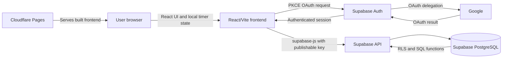

# Chucao Web — Architecture

## 1. Status and sources

**Status:** Architecture baseline, awaiting review  
**Date:** 2026-11-16  
**Scope:** Shared system boundaries, selected technologies, trust boundaries, conceptual data ownership, and architectural constraints for the planned product. This document does not define feature specifications, a complete database schema, or implementation tasks.

**Decision state:** Confirmed, proposed, and open decisions are identified explicitly.  
**Implementation state:** Existing code is described as evidence; planned architecture is not treated as implemented.

**Sources**

- [`docs/global-plan.md`](./global-plan.md): product scope, capabilities, privacy decisions, platforms, and slice order.
- [`docs/quality-project.md`](./quality-project.md): selected quality and security criteria.
- [`temp/archit.md`](../temp/archit.md): agreed stack, authentication approach, local development flow, and login proof reference.
- [`temp/plan.md`](../temp/plan.md): functional behavior, data concepts, consistency constraints, and deployment choices.
- [`package.json`](../package.json): current dependency and script evidence.
- [`supabase/config.toml`](../supabase/config.toml): current local Supabase configuration evidence.
- [`src/lib/supabase.ts`](../src/lib/supabase.ts) and [`src/App.tsx`](../src/App.tsx): current Google authentication proof.

The repository is in early development. The current implementation contains a minimal Google sign-in/sign-out flow, but lists, domain data, RLS policies, migrations, internationalization, and the complete responsive product are not implemented yet.

## 2. Technical context and constraints

Chucao Web is a responsive browser application for PC and Android browsers. It has one web client rather than separate desktop and mobile applications. The same authenticated account data and account-level preferences are available from supported devices; the interface adapts to the viewport.

The planned distribution is:

- Local development with Vite and Supabase CLI running Supabase services through Docker.
- Production frontend hosted by Cloudflare Pages.
- Production data and authentication hosted by a managed Supabase project.
- Google as the only authentication provider for the first version.
- GitHub as the source-control and automation platform.

The product has private user-owned data but public registration is planned for the portfolio release. Public registration does not make lists, concepts, practices, or notes public.

Important shared constraints include:

- The Supabase Auth UUID is the stable application identity; email is not the ownership key.
- Authorization must be enforced at the database/service boundary, not only in React.
- Client validation improves usability but does not replace trusted-boundary validation.
- Random selection and marking a concept as seen must be atomic.
- Retried or repeated requests must not consume another concept or duplicate a practice.
- Active timer/session state is client-only. It is not persisted, synchronized, or resumed across browser instances or devices.
- Account preferences are synchronized data. The initial set is language, default timer duration, sound, volume, and reduced motion.
- The timer duration is between 1 and 59 minutes, and time cannot be added after it starts.
- No custom email/password credential store or password-recovery flow exists in the product architecture.
- Privileged provider secrets never reach the browser bundle.

## 3. Agreed stack

| Area | Technology | Responsibility | State |
|---|---|---|---|
| Language | TypeScript | Application and domain code with static types | Confirmed; present |
| UI | React | Screens, components, and interactive client behavior | Confirmed; present |
| Development/build | Vite | Local development server and frontend build | Confirmed; present |
| Components | Mantine | Reusable controls, dialogs, forms, and responsive component behavior | Confirmed; dependency present; broader use planned |
| Styling | CSS Modules and CSS variables | Product-specific appearance, tokens, responsive styles, and illustration layout | Confirmed; product styling planned |
| Forms | React Hook Form | Form state, validation presentation, and submission state | Confirmed; dependency present; feature use planned |
| Remote data | TanStack Query | Queries, cache, loading/error state, and invalidation for remote data | Confirmed; dependency present; feature use planned |
| Internationalization | `i18next` and `react-i18next` | Spanish/English resources, locale switching, plural and date-aware presentation | Confirmed; dependencies present; wiring planned |
| Typography | Fontsource Comfortaa | Bundled product font | Confirmed; present |
| Auth/data client | `@supabase/supabase-js` | Browser communication with Supabase Auth and data APIs | Confirmed; present |
| Authentication | Supabase Auth with Google OAuth and PKCE | External identity delegation and Chucao session | Confirmed; local proof exists |
| Database | PostgreSQL managed by Supabase | Source of truth for user-owned product data | Confirmed; domain schema planned |
| Authorization | Supabase API and PostgreSQL RLS | Trusted resource isolation and protected data access | Confirmed; policies planned, not yet evidenced |
| Transactions | PostgreSQL functions when required | Atomic selection, marking, and other multi-step operations | Confirmed as a mechanism; functions planned |
| Schema evolution | Versioned SQL migrations | Reproducible database changes, policies, and functions | Confirmed; no domain migrations currently evidenced |
| Local infrastructure | Supabase CLI and Docker | Reproducible local Auth/API/PostgreSQL environment | Confirmed; local configuration present |
| Frontend hosting | Cloudflare Pages | Static frontend artifact hosting and preview/production environments | Confirmed; deployment planned |
| Automation | GitHub Actions | Installation, lint, type-check, tests, and build checks | Confirmed; configuration planned |
| Version control | Git and GitHub | Source history, collaboration, and release inputs | Confirmed; present |

Dependency versions are governed by [`package.json`](../package.json) and its lockfile. This document does not duplicate version ranges.

## 4. Components and responsibilities

### Browser application — planned boundary, partially existing

The React application runs in the user's browser and owns presentation, local interaction state, form feedback, locale presentation, responsive layout, and the active timer/animation state. It may read and write remote product data only through the configured Supabase client.

The browser may contain the public Supabase URL and publishable key. It must not contain Google client secrets, Supabase service-role keys, database credentials, or other privileged values.

Current evidence:

- `src/main.tsx` mounts React, Mantine, Comfortaa, and the current application.
- `src/lib/supabase.ts` creates a PKCE Supabase client with URL/session persistence, URL-session detection, and token refresh.
- `src/App.tsx` starts Google OAuth, observes session changes, displays a minimal signed-in state, and performs local-scope logout.

### Supabase Auth — managed identity boundary

Supabase Auth receives the Google OAuth result, creates or recognizes the Supabase user, issues the Chucao session, and exposes the authenticated identity to database policies. Google owns the underlying Google credentials and account recovery; Chucao does not receive or store the Google password.

### Supabase API and PostgreSQL — planned product-data boundary

Supabase exposes the approved database operations to the authenticated browser client. PostgreSQL will store the product's user-owned data, enforce constraints that must not rely on the client, and apply RLS policies based on the authenticated UUID.

SQL functions are available for operations whose correctness depends on selecting and updating related state atomically. Their exact contracts belong in later specifications and executable migrations.

### Cloudflare Pages — planned delivery boundary

Cloudflare Pages will serve the compiled frontend, provide preview and production environments, and supply environment-specific public configuration. It does not replace Supabase authorization or become the source of truth for product data.

### GitHub Actions — planned verification boundary

GitHub Actions will run the repository's reproducible installation, lint, type-check, test, and build checks. It will not receive production secrets unnecessarily and will not be treated as evidence that runtime authorization or privacy behavior works without those checks.

## 5. Communication and external services

The planned primary flow is:

### Google

- **Purpose:** Only sign-in method for the first version.
- **Receives:** OAuth authorization requests and the permissions required for basic identity.
- **Returns:** OAuth result used by Supabase Auth to establish the Chucao identity/session.
- **Trust boundary:** Google controls Google credentials and account recovery; Chucao trusts the authenticated provider result through Supabase Auth.
- **State:** Confirmed and used by the current local proof; production credentials and redirect configuration are planned.

### Supabase

- **Purpose:** Managed authentication, API, PostgreSQL persistence, RLS enforcement, and local development services.
- **Receives:** Auth requests, authenticated product operations, and user-owned content required by the product.
- **Delegated responsibility:** Provider infrastructure, authentication/session mechanisms, database hosting, managed backups, and service operations.
- **Application responsibility:** Resource ownership rules, data minimization, RLS policies, trusted validation, deletion behavior, and handling of service failures.
- **State:** Confirmed; local configuration exists, while domain schema and production setup are planned.

### Cloudflare Pages

- **Purpose:** Host the compiled frontend and provide preview/production deployment environments.
- **Receives:** The build artifact and deployment configuration; it should not receive privileged database credentials.
- **Operational dependency:** Frontend availability and correct routing/configuration depend on the hosting environment.
- **State:** Confirmed as the target host; deployment not yet evidenced.

### No additional services

No separate application server, queue, file storage, analytics platform, email provider, or custom backup system is part of the confirmed architecture. Adding one would require updating the global plan, privacy review, and this document.

## 6. Conceptual data model and access

The conceptual source of truth for persistent product data is Supabase PostgreSQL. The physical tables, columns, indexes, foreign keys, and migration sequence are deferred to the relevant technical plans and executable migrations.

Known entities and relationships:

- **Authenticated user:** Supabase Auth identity identified by a stable UUID. One user owns their private profile/preferences and product resources.
- **Profile/preferences:** Optional Chucao-specific data linked to the Auth UUID. Preferences are account-level and available from supported devices.
- **List:** User-owned collection of concepts with its own organization and round progress.
- **Concept:** Stable-identity item belonging to one list, with a required title and optional description. Editing text does not change identity or current round state.
- **Round:** A cycle associated with one list. A new round closes the previous one and makes existing concepts available again while retaining prior history.
- **Appearance:** Historical record that a concept was selected or manually marked in a round, including its order and origin. Historical appearances retain the title snapshot used at that time.
- **Practice:** A deliberately saved practice associated with a list concept and, when applicable, its list and round, or an independent practice with a free-text label. Independent practices are persisted only when that label is provided; the label does not create or modify a list concept. A saved practice may have a satisfaction rating from 0 to 5, with `Unrated` distinct from 0. Abandoning an active timer creates no practice record.
- **Practice note:** User-authored note associated with a saved practice. Editing or deleting a note does not delete the practice.

Ownership and access invariants:

- Lists, concepts, rounds, appearances, practices, notes, and preferences are private to the owning Auth UUID.
- A resource is operable only when its ownership chain resolves to the authenticated user.
- The email returned by Google is display/account information, not the stable ownership key.
- The browser is not trusted to assert an owner, role, or protected state.
- Deleted concepts are removed from active use but appear as “Deleted concept” in historical views.
- Permanently deleted lists remove active content and preserve only anonymized historical records.
- Account deletion removes or anonymizes associated active personal/content data, subject to documented provider backup retention.
- The active timer is transient browser state; it is not part of the persistent data model and is not recovered after reload, navigation, abandonment, or device/browser changes.

## 7. Cross-cutting technical constraints

| Source | Architectural consequence | Decision state and timing |
|---|---|---|
| SEC01, SEC04; DP10 | Enforce ownership, permitted fields, state transitions, and private-by-default access in Supabase/RLS or another trusted data boundary. React visibility is not authorization. | Confirmed constraint; policies and tests required before each protected resource is released |
| SEC02, SEC03 | Use parameterized/allowlisted database operations and framework-safe rendering for user-authored text. No raw user content becomes SQL or executable markup. | Confirmed constraint; apply when persistence and rendering are implemented |
| SEC05; DP11 | Use Google/Supabase Auth rather than custom password storage. Link product ownership to the Auth UUID and define logout, session expiry, and account deletion behavior. | Confirmed constraint; verify in the account slice |
| SEC10; DP12, DP19 | Keep OAuth secrets and privileged keys outside the browser and repository; separate local, preview, and production configuration; use synthetic development data. | Confirmed constraint; verify before deployment |
| Q02; global plan atomicity rule | Place random selection/marking and other multi-record invariants in trusted transactional operations, with safe retry behavior. | Confirmed constraint; resolve exact operation contracts in their specs |
| Q05 | Keep schema changes, RLS policies, and SQL functions in versioned migrations and make local setup reproducible with Supabase CLI/Docker. | Confirmed constraint; migrations are planned, not yet evidenced |
| Q03, WEB03, WEB04 | The UI boundary must expose accessible names, focus, errors, language metadata, and meaningful image alternatives; reduced-motion behavior belongs to the client animation boundary. | Confirmed constraint; verify across UI slices |
| DP02, DP05, DP08, DP14, DP18 | The architecture must account for provider flows, logs, backups, deletion, anonymized historical records, and privacy notice content; adding SDKs or providers changes the review. | Confirmed planning constraint; operational evidence required before public registration |
| Q04 and committed platform scope | Avoid unbounded pasted-input processing and define realistic workloads for personal-scale data on modern PC/Android browsers. | Confirmed constraint; refine workload in relevant specs |

Choosing a mechanism such as RLS, PKCE, or managed backups does not by itself prove that the corresponding quality or privacy criterion is met.

## 8. Architectural decisions

### ARCH-01 — Managed Supabase backend

- **State:** Confirmed, planned.
- **Decision:** Use Supabase Auth, API, PostgreSQL, RLS, and managed operational services instead of creating a custom application backend for the initial product.
- **Rationale:** This matches the agreed learning goals and reduces infrastructure while retaining a trusted data boundary.
- **Consequences:** Supabase configuration, provider terms, quotas, backups, migrations, and service availability are architectural dependencies. Application authorization and privacy responsibilities remain with the project.

### ARCH-02 — Google-only authentication with PKCE

- **State:** Confirmed; minimal local implementation exists.
- **Decision:** Use `supabase.auth.signInWithOAuth({ provider: 'google' })` with PKCE. Google manages credentials and recovery; Chucao manages the Supabase session and product authorization.
- **Rationale:** It avoids an application-managed password and email delivery system.
- **Consequences:** Google OAuth credentials, redirect URLs, provider availability, and provider account recovery are required. Email/password forms and custom password recovery are outside the architecture.

### ARCH-03 — Supabase Auth UUID owns resources

- **State:** Confirmed, planned.
- **Decision:** Associate every private product resource with the stable Supabase Auth UUID rather than an email address.
- **Rationale:** Email can change and is not an adequate ownership key.
- **Consequences:** RLS and all service operations must derive identity from the authenticated session; account deletion must traverse the identity-to-content relationship.

### ARCH-04 — RLS is a primary authorization boundary

- **State:** Confirmed, planned.
- **Decision:** Enforce resource isolation in PostgreSQL RLS and trusted service operations, with UI restrictions only as a usability layer.
- **Rationale:** Direct API requests must have the same protection as normal UI flows.
- **Consequences:** Every persisted resource relationship and operation must be designed with ownership in mind. RLS policies require focused review and direct access tests.

### ARCH-05 — Transactional core operations

- **State:** Confirmed, planned.
- **Decision:** Use PostgreSQL functions or equivalent trusted transactions when selection, marking, history, or practice writes must be atomic.
- **Rationale:** Random selection and retries must not produce duplicate or inconsistent state.
- **Consequences:** Operation contracts and idempotency behavior belong in later specs; client-side sequencing cannot be the sole consistency mechanism.

### ARCH-06 — One responsive client, account-level preferences

- **State:** Confirmed, planned.
- **Decision:** Use one responsive web client for PC and Android browsers. Persist user preferences at account level, but keep active timer/session state local to the current browser.
- **Rationale:** Device form factor changes presentation, not product identity or preferences; active timer synchronization is explicitly out of scope.
- **Consequences:** Cross-device reads of saved data and preferences are expected from the first release. Reloading, navigating away, abandoning the practice, or changing device/browser instances ends the local timer without recovery or a practice record; no server-side timer session state is introduced.

### ARCH-07 — Local Supabase mirrors the managed boundary

- **State:** Confirmed, planned.
- **Decision:** Develop against Supabase CLI and Docker locally, with Google OAuth still reached over the internet, then use separate Google and Supabase production projects/configuration.
- **Rationale:** Local services provide reproducible database/Auth development without copying production data.
- **Consequences:** Local and production redirect URLs, secrets, public configuration, and database migrations must remain environment-specific.

## 9. Architectural decisions and deferred detail

| Decision | Architectural impact | State and remaining detail |
|---|---|---|
| Use the conceptual entities User, Profile/Preferences, List, Concept, Round, Appearance, Practice, and Practice Note. Implement migrations in dependency order: profile/preferences, lists, concepts, rounds, appearances, practices, notes, then constraints, RLS, and transactional functions. | Establishes ownership paths and the order in which the physical schema can be introduced without designing every column here. | **Confirmed, planned.** Exact columns, indexes, foreign keys, and migration SQL belong to the relevant specifications and executable migrations. |
| Use deny-by-default RLS based on the authenticated Supabase Auth UUID. A resource is accessible only when its ownership chain resolves to that user; the client cannot choose or change ownership. | Direct API access receives the same isolation as normal UI flows. SQL functions are used for operations that require trusted validation or atomicity. | **Confirmed, planned.** Exact policies and function contracts must be specified and tested before each protected resource is released. |
| Use optimistic concurrency for editable resources. A stale update is rejected explicitly instead of silently overwriting another change. Use atomic database operations for selection, marking, rounds, and other multi-record invariants. | Prevents silent data loss while keeping the application usable across devices. Retried operations must be safe and clients must be able to reload current state after a conflict. | **Confirmed, planned.** The concrete version/timestamp mechanism and idempotency details belong to the affected specifications. |
| Retain active account/content data while the account is active or until deletion is requested. Retain technical logs for 30 days without unnecessary user content; use Supabase's actual session and backup retention; anonymize historical records from permanently deleted lists. | The privacy notice, deletion behavior, diagnostics, and provider review must describe these rules. Backup deletion may not be immediate. | **Confirmed, planned.** Verify Supabase's actual retention values and document exceptions before public registration. |
| Support the current and previous versions of Chrome, Edge, and Firefox on PC, and Chrome on Android. Do not promise support for Internet Explorer, obsolete browsers, embedded browsers, Safari, or iOS in the initial release. | Defines the first compatibility matrix for responsive behavior, authentication redirects, timers, and release validation. | **Confirmed, planned.** Revisit if the target audience expands to iOS/Safari or other platforms. |
| Use local Supabase CLI/Docker, a separate Supabase staging project for preview deployments, and a separate Supabase production project. Use separate Google OAuth credentials and environment variables for local, staging, and production. Promote versioned migrations from staging to production under controlled release. | Prevents previews and tests from changing production data and keeps OAuth redirects, secrets, provider settings, and migrations environment-specific. | **Confirmed, planned.** Select actual provider regions, confirm contractual/transfer evidence, and configure the production projects before public registration. |

The architecture can guide the first authentication/list slices. It is not blocked by deferred physical schema details, but protected domain data must not be released until its ownership paths, RLS policies, and trusted operations are specified and evidenced.

## 10. Implementation references and significant changes

### Current executable references

- [`package.json`](../package.json): current scripts and dependencies.
- [`supabase/config.toml`](../supabase/config.toml): local ports, signup setting, disabled email provider, Google provider environment references, and redirect configuration.
- [`src/lib/supabase.ts`](../src/lib/supabase.ts): current PKCE client configuration, session persistence, and token refresh.
- [`src/App.tsx`](../src/App.tsx): current minimal Google sign-in, session observation, OAuth error handling, and local logout.
- No domain migrations or RLS policy files were found in the current repository snapshot; the conceptual model above is planned rather than implemented.

### Significant changes

| Date | Change | Rationale |
|---|---|---|
| 2026-11-16 | Created the architecture baseline from `temp/archit.md`, `docs/global-plan.md`, `docs/quality-project.md`, and current configuration/code evidence. | Establishes shared boundaries without pre-designing every feature or schema. |
| 2026-11-16 | Recorded Google-only PKCE authentication as both a confirmed architectural decision and a partially existing implementation. | Keeps the architecture aligned with the verified login proof while exposing the remaining account-slice work. |
| 2026-11-16 | Resolved the previous open architecture questions with decisions for the conceptual migration order, RLS boundary, optimistic concurrency, retention baseline, supported browsers, and staging/production environments. | Makes the architecture ready to guide the next specification work while preserving implementation-level detail for later plans. |
