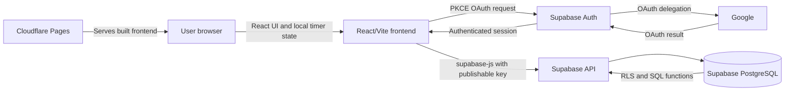

# Chucao Web — Architecture

## 1. Status and sources

**Status:** Shared architecture baseline; local implementation evidence recorded through VS-06
**Date:** 2026-11-19
**Scope:** Shared system boundaries, selected technologies, trust boundaries, conceptual data ownership, and architectural constraints for the planned product. This document does not define feature specifications, a complete database schema, or implementation tasks.

**Decision state:** Confirmed, proposed, and open decisions are identified explicitly.  
**Implementation state:** VS-01–VS-06 application and database boundaries are implemented for local scope and linked to task evidence. VS-05 is closed for validated local scope after the user-confirmed MV-01 journey. VS-06 is closed for validated local scope; it implements owner-scoped list collection/mutations, active-list count serialization, and archived read-only guards, with integrated evidence in [`specs/006-advanced-organization/tasks.md`](../specs/006-advanced-organization/tasks.md). This does not claim complete privacy validation, production deployment, or release readiness. MV-02 runtime browser privacy inspection remains unverified.

**Sources**

- [`docs/global-plan.md`](./global-plan.md): product scope, capabilities, privacy decisions, platforms, and slice order.
- [`docs/quality-project.md`](./quality-project.md): selected quality and security criteria.
- [`temp/archit.md`](../temp/archit.md): agreed stack, authentication approach, local development flow, and login proof reference.
- [`temp/plan.md`](../temp/plan.md): functional behavior, data concepts, consistency constraints, and deployment choices.
- [`package.json`](../package.json): current dependency and script evidence.
- [`supabase/config.toml`](../supabase/config.toml): current local Supabase configuration evidence.
- [`src/lib/supabase.ts`](../src/lib/supabase.ts) and [`src/App.tsx`](../src/App.tsx): current Google authentication proof.

The repository remains in development. The current implementation contains Google sign-in and locally implemented list, concept, round, timer, practice, note, and history journeys, including domain data, RLS policies, and migrations. Full release readiness, runtime browser privacy inspection, and production deployment remain unverified.

## 2. Technical context and constraints

Chucao Web is a responsive browser application for PC and Android browsers. It has one web client rather than separate desktop and mobile applications. The same authenticated account data and account-level preferences are available from supported devices; the interface adapts to the viewport.

The planned distribution is:

- Local development with Vite and Supabase CLI running Supabase services through Docker.
- Production frontend hosted by Cloudflare Pages.
- Production data and authentication hosted by a managed Supabase project.
- Google as the only authentication provider for the first version.
- GitHub as the source-control and automation platform.

The product has private user-owned data but public registration is planned for the portfolio release. Public registration does not make lists, concepts, practices, or notes public.

Important shared constraints include:

- The Supabase Auth UUID is the stable application identity; email is not the ownership key.
- Authorization must be enforced at the database/service boundary, not only in React.
- Client validation improves usability but does not replace trusted-boundary validation.
- Random selection and marking a concept as seen must be atomic.
- Retried or repeated requests must not consume another concept or duplicate a practice.
- Active timer/session state is client-only. It is not persisted, synchronized, or resumed across browser instances or devices; completion or abandonment creates no practice record in VS-04.
- Account preferences are synchronized data. Locale and timer preferences (default duration, sound, volume, and reduced motion) are stored on the owner profile; timer sessions snapshot their effective preferences at entry.
- The timer duration is between 1 and 59 minutes, and time cannot be added after it starts.
- No custom email/password credential store or password-recovery flow exists in the product architecture.
- Privileged provider secrets never reach the browser bundle.

## 3. Agreed stack

| Area | Technology | Responsibility | State |
|---|---|---|---|
| Language | TypeScript | Application and domain code with static types | Confirmed; present |
| UI | React | Screens, components, and interactive client behavior | Confirmed; present |
| Development/build | Vite | Local development server and frontend build | Confirmed; present |
| Components | Mantine | Reusable controls, dialogs, forms, and responsive component behavior | Confirmed; dependency present; broader use planned |
| Styling | CSS Modules and CSS variables | Product-specific appearance, tokens, responsive styles, and illustration layout | Confirmed; implemented in current local views |
| Forms | React Hook Form | Form state, validation presentation, and submission state | Confirmed; used by current forms |
| Remote data | TanStack Query | Queries, cache, loading/error state, and invalidation for remote data | Confirmed; used for owner-scoped queries and cache invalidation |
| Internationalization | `i18next` and `react-i18next` | Spanish/English resources, locale switching, plural and date-aware presentation | Confirmed; wired for current application views |
| Typography | Fontsource Comfortaa | Bundled product font | Confirmed; present |
| Auth/data client | `@supabase/supabase-js` | Browser communication with Supabase Auth and data APIs | Confirmed; present |
| Authentication | Supabase Auth with Google OAuth and PKCE | External identity delegation and Chucao session | Confirmed; local proof exists |
| Database | PostgreSQL managed by Supabase | Source of truth for user-owned product data | Confirmed; VS-01–VS-05 schemas applied and checked locally; production not evidenced |
| Authorization | Supabase API and PostgreSQL RLS | Trusted resource isolation and protected data access | Confirmed; list, concept, round, practice, note, history, and operation boundaries checked locally with synthetic owners |
| Transactions | PostgreSQL functions when required | Atomic selection, marking, and other multi-step operations | Confirmed; VS-03 round operations and VS-05 practice/note operations implemented and checked locally |
| Schema evolution | Versioned SQL migrations | Reproducible database changes, policies, and functions | Confirmed; VS-01–VS-05 migration files applied and linted locally; production not evidenced |
| Local infrastructure | Supabase CLI and Docker | Reproducible local Auth/API/PostgreSQL environment | Confirmed; local configuration present |
| Frontend hosting | Cloudflare Pages | Static frontend artifact hosting and preview/production environments | Confirmed; deployment planned |
| Automation | GitHub Actions | Installation, lint, type-check, tests, and build checks | Confirmed; configuration planned |
| Version control | Git and GitHub | Source history, collaboration, and release inputs | Confirmed; present |

Dependency versions are governed by [`package.json`](../package.json) and its lockfile. This document does not duplicate version ranges.

## 4. Components and responsibilities

### Browser application — implemented client boundary

The React application runs in the user's browser and owns presentation, local interaction state, form feedback, locale presentation, responsive layout, and the active timer/animation state. It may read and write remote product data only through the configured Supabase client.

The browser may contain the public Supabase URL and publishable key. It must not contain Google client secrets, Supabase service-role keys, database credentials, or other privileged values.

Current evidence:

- `src/main.tsx` mounts React, Mantine, Comfortaa, and the current application.
- `src/lib/supabase.ts` creates a PKCE Supabase client with URL/session persistence, URL-session detection, and token refresh.
- `src/App.tsx` owns authenticated navigation and session cleanup; practice/history feature views use owner-scoped services and queries. See section 10 for the VS-05 implementation references.

### Supabase Auth — managed identity boundary

Supabase Auth receives the Google OAuth result, creates or recognizes the Supabase user, issues the Chucao session, and exposes the authenticated identity to database policies. Google owns the underlying Google credentials and account recovery; Chucao does not receive or store the Google password.

### Supabase API and PostgreSQL — implemented local product-data boundary

Supabase exposes approved database operations to the authenticated browser client. PostgreSQL stores product data, enforces constraints that must not rely on the client, and applies RLS policies based on the authenticated UUID. Practice, note, history, pending-account restrictions, and the authenticated account-deletion operation are implemented and checked locally; executable definitions and evidence are linked in section 10. Hosted function secrets/configuration and production behavior remain unverified.

SQL functions implement operations whose correctness depends on selecting and updating related state atomically. Exact contracts are versioned in the selected slice plans and executable migrations; later resources still require their own contracts.

### Cloudflare Pages — planned delivery boundary

Cloudflare Pages will serve the compiled frontend, provide preview and production environments, and supply environment-specific public configuration. It does not replace Supabase authorization or become the source of truth for product data.

### GitHub Actions — planned verification boundary

GitHub Actions will run the repository's reproducible installation, lint, type-check, test, and build checks. It will not receive production secrets unnecessarily and will not be treated as evidence that runtime authorization or privacy behavior works without those checks.

## 5. Communication and external services

The planned primary flow is:

### Google

- **Purpose:** Only sign-in method for the first version.
- **Receives:** OAuth authorization requests and the permissions required for basic identity.
- **Returns:** OAuth result used by Supabase Auth to establish the Chucao identity/session.
- **Trust boundary:** Google controls Google credentials and account recovery; Chucao trusts the authenticated provider result through Supabase Auth.
- **State:** Confirmed and used by the current local proof; production credentials and redirect configuration are planned.

### Supabase

- **Purpose:** Managed authentication, API, PostgreSQL persistence, RLS enforcement, and local development services.
- **Receives:** Auth requests, authenticated product operations, and user-owned content required by the product.
- **Delegated responsibility:** Provider infrastructure, authentication/session mechanisms, database hosting, and service operations. Managed backups depend on the selected plan.
- **Application responsibility:** Resource ownership rules, data minimization, RLS policies, trusted validation, deletion behavior, and handling of service failures.
- **State:** Confirmed; local configuration and VS-01–VS-05 domain schema/operations are implemented. Production setup and provider-retention evidence remain planned.

### Cloudflare Pages

- **Purpose:** Host the compiled frontend and provide preview/production deployment environments.
- **Receives:** The build artifact and deployment configuration; it should not receive privileged database credentials.
- **Operational dependency:** Frontend availability and correct routing/configuration depend on the hosting environment.
- **State:** Confirmed as the target host; deployment not yet evidenced.

### No additional services

Cloudflare Pages production uses Cloudflare Web Analytics to measure site visits and performance. It is configured in Cloudflare, and the application does not send Google account data or user-authored content to it. The confirmed architecture uses provider infrastructure and has no separate application server, queue, file storage, email provider, or custom backup system.

## 6. Conceptual data model and access

The source of truth for persistent product data is Supabase PostgreSQL. Physical details are defined by executable, versioned migrations and their slice plans. VS-05 practice schema, policies, indexes, and trusted operations are implemented in migrations and checked against local Supabase; later resources remain deferred until specified.

Known entities and relationships:

- **Authenticated user:** Supabase Auth identity identified by a stable UUID. One user owns their private profile/preferences and product resources.
- **Profile/preferences:** Optional Chucao-specific data linked to the Auth UUID. Preferences are account-level and available from supported devices.
- **List:** User-owned collection of concepts with its own organization and round progress. A list is Active when its archive marker is null and Archived otherwise. Archived lists retain all content/history and are read-only until restored. The limit of 100 applies to active lists; restoration is rejected at the limit without changing the archived list.
- **Concept:** Stable-identity item belonging to one list, with a required title and optional description. Editing text does not change identity or current round state.
- **Round:** A cycle associated with one list. A new round closes the previous one and makes existing concepts available again while retaining prior history.
- **Appearance:** Historical record that a concept was selected or manually marked in a round, including its order and origin. Historical appearances retain the title snapshot used at that time.
- **Round operation record:** Internal list-scoped record keyed by a client operation UUID. It lets a retry return the original result without repeating a state change; it stores no authored concept text. The physical ledger and RPC contract are defined in the VS-03 migration and plan.
- **Practice:** A deliberately saved practice associated with a list concept and, when applicable, its list and round, or an independent practice with a free-text label. Independent practices are persisted only when that label is provided; the label does not create or modify a list concept. A saved practice may have a satisfaction rating from 0 to 5, with `Unrated` distinct from 0. Abandoning an active timer creates no practice record. The local VS-05 schema is `public.practices`; trusted RPCs enforce eligibility, ownership, and idempotent save.
- **Practice note:** User-authored note associated with a saved practice in `public.practice_notes`. Owner-only detail reads return its current revision for compare-and-swap updates; deletion removes only the note. `public.practice_note_operations` stores text-free operation receipts for safe retries without retaining note payloads; receipts cascade with the practice.

Ownership and access invariants:

- Lists, concepts, rounds, appearances, practices, notes, and preferences are private to the owning Auth UUID.
- A resource is operable only when its ownership chain resolves to the authenticated user.
- Archived lists may be read by their owner, but every list-linked write (list/concept edits, concepts, round state, associated practice save, and associated note mutations) must reject while the parent list is archived. The trusted boundary enforces this; hiding UI controls is insufficient. List collection search/order is owner-scoped and uses allowlisted sort choices.
- Create, duplicate, archive, restore, and permanent list deletion serialize active-list counts against the owner profile row. At 100 active lists, a restore is rejected and leaves the archived row unchanged; archived lists do not count toward the active cap.
- Round and concept state-changing operations for one list take the parent-list lock first and execute in one order. Retries use the same operation UUID; the trusted boundary derives identity from `auth.uid()`.
- Note mutations lock the parent list before an associated practice, or only the practice for an independent record. The expected note revision prevents stale overwrites; operation UUIDs are bound to a payload fingerprint and receipts cascade with the practice.
- When a concept is deleted, preserve its historical title in past round/practice history and visibly mark it with a localized deleted status. Preserve appearance order and origin; remove the concept from active use so it cannot be practiced again.
- Legacy deleted-concept appearances whose title snapshot is null display the localized “Concepto eliminado — título no disponible” / “Deleted concept — title unavailable” fallback. Do not infer or reconstruct the removed title.
- The email returned by Google is display/account information, not the stable ownership key.
- The browser is not trusted to assert an owner, role, or protected state.
- Permanently deleted lists remove active content and preserve only anonymous round totals. Delete associated saved practices and notes; remove owner/list/concept identifiers, authored content, operation identifiers, exact event timestamps, and per-concept appearance detail from retained round records. Verify re-identification risk under DP14 before relying on the anonymization claim.
- Anonymous round totals have no owner/list link and are excluded from private History. Actual re-identification risk, provider retention, and backup handling remain release/privacy review items.
- Account deletion removes or anonymizes associated active personal/content data, subject to documented provider backup retention.
- The active timer is transient browser state; it is not part of the persistent data model and is not recovered after reload, navigation, abandonment, or device/browser changes.

## 7. Cross-cutting technical constraints

| Source | Architectural consequence | Decision state and timing |
|---|---|---|
| SEC01, SEC04; DP10 | Enforce ownership, permitted fields, state transitions, and private-by-default access in Supabase/RLS or another trusted data boundary. React visibility is not authorization. | Confirmed; VS-01–VS-07 local database and account-deletion boundaries plus client session/UI integration are implemented and checked with synthetic identities; hosted behavior remains unverified |
| SEC02, SEC03 | Use parameterized/allowlisted database operations and framework-safe rendering for user-authored text. No raw user content becomes SQL or executable markup. | Confirmed constraint; apply when persistence and rendering are implemented |
| SEC05; DP11 | Use Google/Supabase Auth rather than custom password storage. Link product ownership to the Auth UUID and define logout, session expiry, and account deletion behavior. | Confirmed; local account status/session gates and Account UI are implemented; deletion uses the verified caller's Auth UUID and server-side Auth Admin. Hosted configuration and real Google OAuth remain unverified |
| SEC10; DP12, DP19 | Keep OAuth secrets and privileged keys outside the browser and repository; separate local, preview, and production configuration; use synthetic development data. | Confirmed constraint; local Edge Runtime tested with local keys; hosted secret configuration must be verified before deployment |
| Q02; global plan atomicity rule | Place random selection/marking and other multi-record invariants in trusted transactional operations, with safe retry behavior. | Confirmed; VS-03 implements parent-list serialization and same-UUID replay; VS-05 adds explicit practice save and revision-checked note replay. Local evidence is recorded; future operation contracts remain spec-specific |
| Q05 | Keep schema changes, RLS policies, and SQL functions in versioned migrations and make local setup reproducible with Supabase CLI/Docker. | Confirmed; VS-01–VS-07 migrations and local setup are evidenced by clean local reconstruction and regression runners; production rollout remains unverified |
| Q03, WEB03, WEB04 | The UI boundary must expose accessible names, focus, errors, language metadata, and meaningful image alternatives; reduced-motion behavior belongs to the client animation boundary. | Confirmed constraint; verify across UI slices |
| DP02, DP05, DP08, DP14, DP18 | The architecture must account for provider flows, logs, backups, deletion, anonymized historical records, and privacy notice content; adding SDKs or providers changes the review. | Confirmed planning constraint; operational evidence required before public registration |
| Q04 and committed platform scope | Avoid unbounded pasted-input processing and define realistic workloads for personal-scale data on modern PC/Android browsers. | Confirmed constraint; refine workload in relevant specs |

Choosing a mechanism such as RLS, PKCE, or managed backups does not by itself prove that the corresponding quality or privacy criterion is met.

## 8. Architectural decisions

### ARCH-01 — Managed Supabase backend

- **State:** Confirmed, planned.
- **Decision:** Use Supabase Auth, API, PostgreSQL, RLS, and managed operational services instead of creating a custom application backend for the initial product.
- **Rationale:** This matches the agreed learning goals and reduces infrastructure while retaining a trusted data boundary.
- **Consequences:** Supabase configuration, provider terms, quotas, backups, migrations, and service availability are architectural dependencies. Application authorization and privacy responsibilities remain with the project.

### ARCH-02 — Google-only authentication with PKCE

- **State:** Confirmed; minimal local implementation exists.
- **Decision:** Use `supabase.auth.signInWithOAuth({ provider: 'google' })` with PKCE. Google manages credentials and recovery; Chucao manages the Supabase session and product authorization.
- **Rationale:** It avoids an application-managed password and email delivery system.
- **Consequences:** Google OAuth credentials, redirect URLs, provider availability, and provider account recovery are required. Email/password forms and custom password recovery are outside the architecture.

### ARCH-03 — Supabase Auth UUID owns resources

- **State:** Confirmed; locally implemented for VS-01–VS-05 resources.
- **Decision:** Associate every private product resource with the stable Supabase Auth UUID rather than an email address.
- **Rationale:** Email can change and is not an adequate ownership key.
- **Consequences:** RLS and all service operations must derive identity from the authenticated session; account deletion must traverse the identity-to-content relationship.

### ARCH-04 — RLS is a primary authorization boundary

- **State:** Confirmed; locally implemented and directly checked for VS-01–VS-05 resources using synthetic owners and anonymous clients.
- **Decision:** Enforce resource isolation in PostgreSQL RLS and trusted service operations, with UI restrictions only as a usability layer.
- **Rationale:** Direct API requests must have the same protection as normal UI flows.
- **Consequences:** Every persisted resource relationship and operation must be designed with ownership in mind. RLS policies require focused review and direct access tests.

### ARCH-05 — Transactional core operations

- **State:** Confirmed; VS-03 round and concept operations and VS-05 practice/note operations are locally implemented and checked.
- **Decision:** Use PostgreSQL functions or equivalent trusted transactions when selection, marking, history, or practice writes must be atomic.
- **Rationale:** Random selection, per-list ordering, and retries must not produce duplicate or inconsistent state.
- **Consequences:** VS-03 uses a parent-list row lock and a list-scoped idempotency ledger. Later multi-record features must define and verify their own operation contracts; client-side sequencing cannot be the sole consistency mechanism.

### ARCH-06 — One responsive client, account-level preferences

- **State:** Confirmed; responsive application shell, account-level preferences, and transient timer are implemented locally. Release browser support remains pending.
- **Decision:** Use one responsive web client for PC and Android browsers. Persist user preferences at account level, but keep active timer/session state local to the current browser.
- **Rationale:** Device form factor changes presentation, not product identity or preferences; active timer synchronization is explicitly out of scope.
- **Consequences:** Cross-device reads of saved data and preferences are expected from the first release. Reloading, navigating away, abandoning the practice, or changing device/browser instances ends the local timer without recovery or a practice record; no server-side timer session state is introduced.

### ARCH-07 — Local Supabase mirrors the managed boundary

- **State:** Confirmed, planned.
- **Decision:** Develop against Supabase CLI and Docker locally, with Google OAuth still reached over the internet, then use separate Google and Supabase production projects/configuration.
- **Rationale:** Local services provide reproducible database/Auth development without copying production data.
- **Consequences:** Local and production redirect URLs, secrets, public configuration, and database migrations must remain environment-specific.

### ARCH-08 — Authenticated account deletion uses a server-side Supabase boundary

- **State:** Implemented and locally checked for VS-07; hosted configuration and provider behavior remain unverified.
- **Decision:** The `delete-account` Edge Function validates a bearer token through Supabase Auth, derives the sole target UUID from the verified user, confirms a durable pending marker through the caller-scoped RPC, and uses the server-only service-role credential to delete that same Supabase Auth user. It reconciles failed/uncertain deletion against that UUID and only marks completion when Auth deletion is confirmed. It does not call Google or delete the underlying Google account.
- **Rationale:** Auth Admin deletion requires elevated authority; keeping that credential in the Edge Function preserves the browser trust boundary while supporting pending retries.
- **Consequences:** `SUPABASE_SERVICE_ROLE_KEY` must exist only in the Edge Function runtime. Local `verify_jwt = false` is safe only because the handler verifies every bearer with `auth.getUser`; hosted gateway/function configuration must preserve equivalent enforcement. The non-cascading deletion marker remains restricted to the trusted service boundary. A synthetic isolated restore fixture verified manifest replay before access and kept the candidate unavailable after failed replay; provider backup expiry/access and the duration for retaining deletion state remain subject to OQ-07.

## 9. Architectural decisions and deferred detail

| Decision | Architectural impact | State and remaining detail |
|---|---|---|
| Use the conceptual entities User, Profile/Preferences, List, Concept, Round, Appearance, Round operation record, Practice, and Practice Note. Implement migrations in dependency order: profile/preferences, lists, concepts, rounds, appearances, practices, notes, then constraints, RLS, and transactional functions. | Establishes ownership paths and the order in which the physical schema can be introduced without designing every column here. | **Partly implemented:** VS-01–VS-05 schemas, practice/note storage, and trusted operations are locally applied and checked. Future protected resources remain subject to their own policies and tests. |
| Use deny-by-default RLS based on the authenticated Supabase Auth UUID. A resource is accessible only when its ownership chain resolves to that user; the client cannot choose or change ownership. | Direct API access receives the same isolation as normal UI flows. SQL functions are used for operations that require trusted validation or atomicity. | **Partly implemented:** VS-01–VS-03 resource policies and function contracts are locally checked. Future protected resources still require their own policies and tests. |
| Represent list archival as a trusted list state. Archived lists retain their content/history and are owner-readable but read-only; only the owner may restore them. Keep the maximum of 100 active lists; reject restoration at that limit without changing the archived list. Every list-linked mutation enforces the active-state rule at the trusted boundary. | UI state alone cannot prevent direct calls to concept, round, practice, or note operations against archived data. | **Confirmed and implemented locally for VS-06:** the owner-scoped archive/restore RPCs enforce the active-list limit, archived detail exposes restoration while remaining read-only, and list-linked mutations reject archived parents at the trusted boundary. CHECK-03/04 passed in the synthetic local DB runner; focused UI evidence is recorded in `specs/006-advanced-organization/tasks.md`. Production deployment and broader privacy/release checks remain outstanding. |
| Use optimistic concurrency for editable resources. A stale update is rejected explicitly instead of silently overwriting another change. Use atomic database operations for selection, marking, rounds, and other multi-record invariants. | Prevents silent data loss while keeping the application usable across devices. Retried operations must be safe and clients must be able to reload current state after a conflict. | **Partly implemented:** VS-03 serializes list-scoped state changes, and VS-05 adds revision-checked note mutations with safe operation replay; both are locally checked. Future operation contracts remain spec-specific. |
| Retain active account/content data while the account is active or until deletion is requested. Supabase Free documents one day of API and database log retention. The initial production configuration has no project backups or point-in-time recovery. Permanently deleted lists retain only anonymous round totals after associated practices and notes are deleted. | The privacy notice describes the actual plan and the possibility of unrecoverable data loss. Any future backup strategy must address how deletion and restriction states are reapplied before restoring access. | **Initial launch configuration confirmed by the owner.** Local recovery-fixture evidence is recorded separately. |
| Support the current and previous versions of Chrome, Edge, and Firefox on PC, and Chrome on Android. Do not promise support for Internet Explorer, obsolete browsers, embedded browsers, Safari, or iOS in the initial release. | Defines the first compatibility matrix for responsive behavior, authentication redirects, timers, and release validation. | **Confirmed, planned.** Revisit if the target audience expands to iOS/Safari or other platforms. |
| Use local Supabase CLI/Docker, a separate Supabase staging project for preview deployments, and a separate Supabase production project. Use separate Google OAuth credentials and environment variables for local, staging, and production. Promote versioned migrations from staging to production under controlled release. | Prevents previews and tests from changing production data and keeps OAuth redirects, secrets, provider settings, and migrations environment-specific. | **Confirmed, planned.** Select actual provider regions, confirm contractual/transfer evidence, and configure the production projects before public registration. |

Some status cells above retain the implementation snapshot from the earlier VS-01–VS-03 reviews. The current local implementation also includes VS-04 and VS-05 practice, note, and history boundaries; their ownership paths, RLS policies, RPCs, migrations, and evidence are linked below. Local checks do not verify deployment, provider retention, browser runtime privacy diagnostics, or release readiness; each protected resource still requires an evidenced trusted boundary before release.

## 10. Implementation references and significant changes

### Current executable references

- [`package.json`](../package.json): current scripts and dependencies.
- [`supabase/config.toml`](../supabase/config.toml): local ports, signup setting, disabled email provider, Google provider environment references, and redirect configuration.
- [`src/lib/supabase.ts`](../src/lib/supabase.ts): current PKCE client configuration, session persistence, and token refresh.
- [`src/App.tsx`](../src/App.tsx): Google/Supabase session lifecycle, account-deletion status gate before profile/private-state initialization, Preferences-to-Account navigation, localized pending/retry/confirmed handling, OAuth error handling, and local sign-out.
- [`src/features/practice/practiceService.ts`](../src/features/practice/practiceService.ts) owns explicit practice save/reconciliation and note mutation RPC calls; [`src/features/history/historyService.ts`](../src/features/history/historyService.ts) parses bounded owner history and ordered round appearances. `App.clearPrivateState` removes owner-scoped practice/history query caches on session changes.
- VS-01–VS-07 domain migrations, RLS/trusted-operation functions, and the account-deletion Edge Function are locally applied/checked. The Edge Function lives at [`supabase/functions/delete-account/index.ts`](../supabase/functions/delete-account/index.ts); the account marker/read/write guards are in [`supabase/migrations/`](../supabase/migrations/). It keeps Auth Admin authority server-side, binds deletion to the verified caller, and returns only state/error results. See [`specs/005-notes-and-history/tasks.md`](../specs/005-notes-and-history/tasks.md), [`specs/006-advanced-organization/tasks.md`](../specs/006-advanced-organization/tasks.md), [`specs/007-publication-readiness/tasks.md`](../specs/007-publication-readiness/tasks.md), and [`README.md`](../README.md) for commands, results, and limitations. No production migration or deployment is claimed.

### VS-06 reference

- [`supabase/migrations/`](../supabase/migrations/): VS-06 locally applied migrations for list collection/search, trusted rename/archive/restore, duplicate/permanent delete, and archived parent write guards.
- [`specs/006-advanced-organization/tasks.md`](../specs/006-advanced-organization/tasks.md): task state and local evidence for focused UI/service tests, the 37-check synthetic DB runner, regression/build/lint, static review, and user-confirmed integrated UI flows. No production deployment or re-identification/provider/backup review is claimed.

### VS-07 account-deletion reference

- [`supabase/functions/delete-account/index.ts`](../supabase/functions/delete-account/index.ts) and [`supabase/config.toml`](../supabase/config.toml): local Edge Function JWT verification behavior and function route configuration. The handler itself validates the caller through Supabase Auth because local gateway JWT verification is disabled to return stable unauthorized responses.
- [`supabase/tests/run-delete-account-local.mjs`](../supabase/tests/run-delete-account-local.mjs): real local Edge Runtime integration with synthetic owner A/B, including missing/invalid JWT, caller-supplied target rejection, retry from pending, completed marker, owner isolation, and cleanup.
- [`supabase/tests/run-restore-fixture-local.mjs`](../supabase/tests/run-restore-fixture-local.mjs): isolated local snapshot/manifest replay for pending and completed deletion states, active-owner access, failed-replay isolation, and temporary artifact cleanup; it does not establish provider-backup behavior.
- [`specs/007-publication-readiness/tasks.md`](../specs/007-publication-readiness/tasks.md): T01–T13 implementation and local regression evidence. Google OAuth account deletion is not invoked; hosted Edge secrets, provider retention, and production rollout remain pending.

### Significant changes

| Date | Change | Rationale |
|---|---|---|
| 2026-11-18 | Recorded the locally validated VS-04 boundary: constrained account timer preferences, narrow profile update access, and transient in-memory timer/scene state without recovery or practice persistence. | Keeps the architecture aligned with the delivered slice and preserves VS-05 practice records and VS-07 release review as separate scope. |
| 2026-11-18 | Recorded the locally validated VS-03 round boundary: list-scoped operation ledger, parent-list serialization, fixed-search-path RPCs, RLS, and retained appearance history. | Keeps the shared ownership and atomicity architecture aligned with the closed local slice while leaving physical schema and functions in the executable migrations/spec. |
| 2026-11-18 | Recorded accepted VS-03 deletion handling: retain only anonymous round totals after permanent list deletion and remove links/content/event detail. | Minimizes retained history and aligns round persistence with the accepted global deletion boundary, subject to DP14 review. |
| 2026-11-18 | Clarified historical title retention on concept deletion: preserve the historical title and visibly mark it as deleted, preserving appearance order and origin. | Aligns the architecture with the confirmed VS-05 decision while preventing deleted concepts from returning to active practice. |
| 2026-11-18 | Confirmed permanent list deletion removes associated practices and notes and retains only anonymous round totals. | Defines the saved-practice lifecycle consistently with the global minimum-retention rule. |
| 2026-11-18 | Implemented local VS-05 note update/delete RPCs with parent-first locking, revision compare-and-swap, operation replay and text-free receipts; the local runner validates concurrent update/delete behavior and owner isolation. | Aligns the shared concurrency and privacy boundaries with the executable note mutation contract; no browser note editor is included in T08. |
| 2026-11-19 | Added associated note management from list context, including practices whose concepts were deleted; note content is loaded only after an explicit entry selection and deletion refreshes the list/history metadata. | Keeps note text out of list rows and preserves a route to retained historical notes without restoring deleted concepts. |
| 2026-11-19 | Recorded the local VS-05 schema/service/lifecycle boundary: explicit practice persistence, revision-protected note updates, bounded private history, legacy-null title fallback, and anonymous round-total exclusion. | Aligns the conceptual architecture with executable migrations and local evidence while retaining release privacy and provider-retention limits. |
| 2026-11-19 | Updated the VS-06 implementation boundary and evidence references after T01–T10 local completion. | Records owner-scoped list operations and archived write protections as implemented and locally checked while retaining separate spec validation and publication/privacy conditions. |
| 2026-11-19 | Recorded the confirmed VS-06 archive/read-only state, active-list cap on restore, and required trusted guard for all list-linked mutations. | Preserves content/history while preventing direct service requests from changing archived lists; implementation remains planned in the selected slice. |
| 2026-11-20 | Added the locally implemented VS-07 account-deletion trust boundary: pending/read/write guards, caller-bound Edge Function Auth deletion, and local synthetic integration evidence. | Keeps elevated Auth Admin authority outside the browser and makes the Supabase Auth UUID the only deletion target; hosted configuration, UI/session integration, and backup retention remain pending. |
| 2026-11-16 | Created the architecture baseline from `temp/archit.md`, `docs/global-plan.md`, `docs/quality-project.md`, and current configuration/code evidence. | Establishes shared boundaries without pre-designing every feature or schema. |
| 2026-11-16 | Recorded Google-only PKCE authentication as both a confirmed architectural decision and a partially existing implementation. | Keeps the architecture aligned with the verified login proof while exposing the remaining account-slice work. |
| 2026-11-16 | Resolved the previous open architecture questions with decisions for the conceptual migration order, RLS boundary, optimistic concurrency, retention baseline, supported browsers, and staging/production environments. | Makes the architecture ready to guide the next specification work while preserving implementation-level detail for later plans. |
