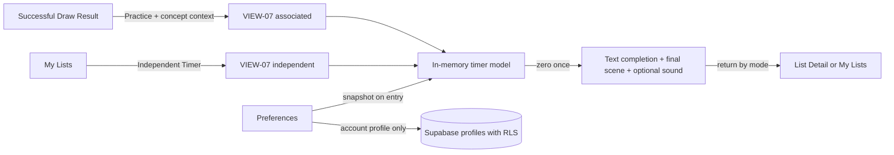

# VS-04 Timed Practice Journey — Technical Plan

## 1. Status and references

| Field | Value |
|---|---|
| Spec | [`spec.md`](./spec.md), state `Ready for technical planning` |
| Slice | `VS-04 Timed practice journey` |
| Plan state | Ready for task breakdown |
| Scope | FR-01–FR-10, NFR-01–NFR-07, AC-01–AC-13 |
| Product source revision | Current clarified spec in this repository; no separate revision identifier is defined |

This plan follows `docs/architecture.md` (account-owned profile and transient timer boundaries), `docs/global-plan.md` (selected VS-04 scope), `docs/app-flow.md` (FLOW-05/06 and VIEW-06/07), and `docs/design.md` (VIEW-06/07/10, accessibility, and timer resources). It also uses the visual and timing guidance in `temp/design.md`, section 11, and the four-stage visual reference `temp/capturas/referencia.png` (background rest, flight, near-destination landing, and final arrival/call). The reference file is present at that path and was inspected for this plan.

Applicable quality and privacy controls are Q01–Q06, SEC01, SEC03, SEC04, SEC08, SEC10, WEB03, WEB04; DP02, DP10, DP12–DP14; and V01, V03–V10 as selected in the spec. VS-01–VS-03 are implemented foundations; their screens and patterns are reuse evidence, while VIEW-07 remains new work.

## 2. Existing implementation and reuse

- `src/App.tsx` owns the authenticated shell, selected-list navigation, locale toggle, and current Preferences `Modal`. Add the timer view state and route callbacks here without introducing a routing dependency or changing auth/session ownership. The existing Preferences dialog must retain privacy, locale, identity, and sign-out behavior.
- `src/features/rounds/DrawResultModal.tsx` is the cream, centered result dialog. Add a secondary `Practice` action while preserving the return-to-list action and its current result context. The owning list-detail flow should pass the selected active concept and list identity to the timer entry.
- `src/features/lists/MyListsView.tsx` and `src/features/lists/lists.module.css` provide the current list panel and action styling. Add the lilac Independent Timer entry here, including the empty-list state, without coupling it to list data.
- Existing feature styles use Mantine and CSS Modules, with Chucao semantic colors, borders, offset shadows, responsive layouts, and visible focus. Reuse those conventions from `src/app/app.module.css`, `src/features/lists/lists.module.css`, and `src/features/rounds/rounds.module.css`. The timer scene is a purpose-built SVG composition, not a new UI framework.
- `src/features/preferences/preferencesService.ts` already verifies the authenticated Supabase UUID before profile reads/writes. Extend this service with an allowlisted timer-preference contract and maintain the same error mapping. `src/lib/database.types.ts` and the generated-style profile types currently expose only `locale`.
- The current `profiles` table, owner-only RLS policy, `set_updated_at` trigger, and column-specific update grant are in `supabase/migrations/20261116210000_vs01_account_and_first_private_list.sql`. New timer columns need a forward-only migration, constraints, and a grant limited to those columns; do not broaden update access. The Auth UUID remains the owner identity.
- Existing UI tests use Vitest, React Testing Library, `user-event`, Mantine providers, and mocked service boundaries (`MyListsView.test.tsx`, `ConceptManagementView.test.tsx`). `roundService.test.ts` demonstrates focused service tests. No E2E or browser automation framework is present; no additional test dependency is justified.
- Approved assets already exist at `src/assets/fly1.png`, `src/assets/fly2.png`, `src/assets/tronco.png`, and `src/assets/chucao.wav`. The chucao images and trunk are owner-created and need no separate credit. Audio and creator/font credit requirements are already recorded in the root README; the Preferences section is still to be implemented.
- No timer feature, preference schema, or practice history exists in the current code. VS-04 must not add a practice table, timer recovery storage, analytics, or practice closure behavior.

## 3. Proposed changes by component

| Component/path | Responsibility and proposed change | Requirements |
|---|---|---|
| `src/App.tsx` and app-level state | Add one in-memory navigation state for associated or independent practice, selected concept context, and return destination. Render VIEW-07 inside the existing authenticated shell. Intercept only app navigation while running/paused and offer stay/abandon. Session expiry clears transient timer and private view state through the existing auth transition. | FR-01, FR-06, FR-08, FR-09; NFR-01, NFR-04 |
| `src/features/rounds/DrawResultModal.tsx` and list-detail caller | Add `Practice` only for a successful draw; pass the active concept's current title/description and list context. Preserve the existing Back to list action and draw flow. Do not change round persistence or draw semantics. | FR-01, FR-04; AC-01 |
| `src/features/lists/MyListsView.tsx` | Add an independent-timer entry with the agreed lilac action style and touch target, available whether or not lists exist. | FR-01; AC-02; NFR-01 |
| New `src/features/practice/` feature | Add `PracticeView`, a pure timer/timeline module, a forest scene component, timer controls, and focused CSS Module(s). Hold state only in React memory. The view handles prepared/running/paused/completed, duration validation, context-specific title/description, restart confirmation, completion return, and textual status. | FR-01–FR-06, FR-08, FR-09; NFR-01, NFR-03, NFR-05 |
| New `src/features/practice/ForestTimerScene.tsx` plus SVG/CSS Module | Build one fixed-camera scene matching the supplied illustration: pale sky and distant tree silhouettes, curving beige path, layered green banks, side framing plants, five progressively larger alternating supports, and the large near-left trunk. Keep landscape static. Animate only bird position/scale, shadow, and short call waves. Use `fly1.png`/`fly2.png` for flight and a resting frame already in the approved asset set; use `tronco.png` for supports. Keep decorative layers hidden from assistive technology. | FR-05, FR-08; NFR-01, NFR-05; WEB04 |
| `src/features/preferences/preferencesService.ts`, `src/lib/database.types.ts`, new Supabase migration | Add nullable/account-owned `default_timer_minutes`, `completion_sound_enabled`, `sound_volume`, and `reduced_motion` profile columns. Validate range/type at the database and service boundary, and update only those columns plus existing locale permission. Null reduced-motion means “follow OS/browser preference”; null/default timer fields are interpreted per the spec (1, enabled, 50). Update profile row/insert/update contracts consistently. | FR-07, FR-09; NFR-02, NFR-06; SEC01, SEC04; DP10, DP14 |
| Preferences UI, likely an extracted `TimerPreferences` component under `src/features/preferences/` | Extend the existing dialog with four timer preferences, explicit save states and retry, 0–100 slider, preview button, reduced-motion override, and a concise Credits and Licenses section. Keep current locale/privacy/email/sign-out controls in their current hierarchy. Capture effective preferences when a timer session is entered so subsequent preference changes cannot mutate that session. | FR-07, FR-08, FR-09, FR-10; NFR-01, NFR-05, NFR-07 |
| `src/i18n/resources.ts` | Add Spanish/English labels, help, validation, save/retry, timer states, confirmation, completion, sound-preview outcomes, accessibility names, and all credits/license text and links. Never translate user-authored concept content. | FR-08–FR-10; NFR-05, NFR-07; WEB03 |
| Existing preferences/README documents | Keep the README credit content already present; render equivalent source/license information in Preferences. No broad shared-document changes are required for implementation. | FR-10; NFR-07 |

### Journey wiring



## 4. Data model, contracts, and compatibility

### Persistent preference contract

Add only four nullable fields to the existing one-row-per-Auth-user profile. Suggested SQL types are `smallint` for duration and volume, `boolean` for sound, and nullable `boolean` for reduced motion. Add checks requiring duration `1..59` and volume `0..100`; null remains allowed for unset/default migration state. Sound null maps to enabled. Reduced motion null is semantically distinct and follows `matchMedia('(prefers-reduced-motion: reduce)')`, falling back to full animation if unavailable. Existing profiles are not rewritten into explicit reduced-motion choices.

The browser service must reject malformed values before sending; PostgreSQL constraints remain authoritative for direct requests. RLS stays `id = auth.uid()` with `WITH CHECK`, and column grants name only the four new fields (plus the existing `locale` grant). No client-supplied owner ID is persisted. A read/write operates on the current user only and returns the selected preference fields, not unrelated profile data. The migration is additive and gives existing rows the same effective defaults as new accounts.

Proposed application type:

```ts
type TimerPreferences = {
  defaultDurationMinutes: number; // effective 1..59, default 1
  completionSoundEnabled: boolean; // effective default true
  soundVolume: number; // UI 0..100, effective default 50
  reducedMotion: boolean | null; // null follows system preference
};
```

Preference writes should be a single update of the selected allowlisted value (or a single validated preference patch if the existing control pattern batches changes). Display `saved` only after Supabase acknowledges the write. On error/timeout, retain the current local selection, mark it unsaved, and retry the same value idempotently. Never treat an optimistic local value as an account save.

### Transient session contract

Timer session data exists only in component/application memory: mode, optional concept/list identity and display text already authorized by the current view, selected duration, state, remaining/deadline information, and a preference snapshot. It must not be placed in `localStorage`, `sessionStorage`, IndexedDB, a URL, logs, telemetry, or a database row. Reload and auth loss discard it. No schema for practice or timer sessions is added.

Associated context is passed from the successful draw result rather than refetched by title. If the current auth session changes or the owning view invalidates its active context before entry, clear it and use the existing authentication/return path; never retain private text across a user change. Render title/description as React text nodes.

### Sound mapping

The visible slider is integer 0–100. `0` maps to silence. For audible values, interpolate in dB over two contiguous ranges: `1..50` maps from `-60 dB` through `-30 dB`, and `50..100` maps from `-30 dB` through `0 dB`. Convert the resulting dB to linear media gain with `10 ** (dB / 20)`. This preserves the agreed anchors (`1` is `-60 dB`, `50` is `-30 dB`, and `100` is app maximum) while keeping every integer slider step monotonic. Keep the UI value as the persisted value; perform conversion only at the audio boundary. Reuse one imported audio resource. Preview is an explicit, one-shot user action at the current selected volume even when completion sound is off. It must not mutate timer state or sound-enabled preference. Stop/release a previous preview before starting another; handle rejected `play()` promises as browser-blocked feedback, not playback success.

## 5. Algorithms and failure handling

### Timer clock and transitions

Use elapsed wall-clock time to determine truth; a periodic UI update only refreshes visible values. Keep a `deadline/startedAt` plus remaining milliseconds in memory. Start sets the deadline from current time and selected duration. Pause recomputes remaining time and freezes it; resume creates a new deadline from the frozen remainder. Restart confirmation resets to the full selected duration and prepared state. Cancellation is a no-op. At or beyond zero, transition to completed once, clamp to zero, stop the running ticker, set scene to destination, and trigger a single sound attempt if enabled. A per-run completion guard resets only on confirmed restart/new session.

Use `Date.now()` (epoch wall clock) for elapsed calculation so the timer can account for time while a device is locked/asleep; do not count interval callbacks. Refresh the visible countdown at most once per second while resting, and at a bounded 100 ms cadence only during a short flight for sprite/position rendering. Recompute immediately on `visibilitychange`/focus. A browser can throttle callbacks, but on return the computed remaining time is correct. System clock changes can affect wall-clock elapsed time; document this as an implementation limitation rather than promising an OS-level monotonic background timer. Control time with fake system time in automated tests.

### Forest animation schedule

Treat `temp/design.md` section 11.3 as the initial schedule and map the reference's four visual stages to the four flights. For selected duration `D` seconds, require `D >= 60` (already enforced by FR-02); use flight durations `[4, 3, 2, 1]` seconds, totaling 10 seconds, and split `D - 10` evenly across four stationary waits. Sequence from far-left support: wait, flight 1, wait, flight 2, wait, flight 3, wait, flight 4, then completed at the large near-left support. This preserves the approved four-flight/4-3-2-1 design and fits both duration bounds without negative or zero waits. Compute every scene snapshot from elapsed time, not accumulated frame deltas; pause freezes the snapshot, resume continues from it, and background return seeks directly to the corresponding phase. During flight, interpolate along four authored SVG paths with a smooth ease-in/out, increasing scale between supports; align the sprite's feet pivot with each support. Alternate the two approved flight frames every 100 ms derived from flight-local elapsed time. Keep shadow scale/opacity paired to the same interpolation; show call-wave curves only at arrival/completion.

With reduced motion enabled, show the bird static on the nearest foreground support and keep the timer/progress/completion text fully active; without an explicit saved setting, use the system media query if available and otherwise full motion. Snapshot the effective motion setting on timer entry, like other session preferences. The final/static art does not itself signal completion: only the logical timer state and textual status do.

### Preference timing and failures

- On account preference load failure, keep the timer usable with effective defaults and an actionable read-error state in Preferences; do not claim those defaults were loaded/saved from the account.
- Preference edits update the preference view immediately, then save. Errors retain the selected value as unsaved and allow retry. Multiple writes for the same field should be serialized or last-write-wins with a request sequence guard so late responses do not restore stale UI state.
- Each timer entry snapshots the then-current effective preferences. Updates made in Preferences while VIEW-07 is open apply only to later entries, including if the timer is prepared, running, paused, or completed.
- Browser autoplay can block a delayed completion sound despite the earlier Start action. Keep completion visible, make one attempt only, and report playback failure only if it can be done without obscuring completion. Never claim sound played unless `play()` resolves.
- Animation asset load failure uses a static SVG/support fallback and retains numeric/text timer status. A sound failure does not affect timer completion.
- In-app navigation from running or paused shows a localized continue/abandon confirmation. Continue closes it and leaves state unchanged; a running clock continues while the dialog is open. Abandon clears the in-memory timer and returns to the context destination. Prepared/completed leave directly. Reload/close cannot be reliably intercepted and must not be described as recoverable.
- Session expiry/user change discards timer and concept context. Existing auth continuation/error handling remains responsible for sign-in. No hidden recovery draft is kept.

## 6. Technical decisions and rationale

| Decision | Choice and rationale | State |
|---|---|---|
| Timer persistence | React/application memory only; no recovery store or practice record. This exactly preserves the transient boundary and minimizes private data. | Confirmed by spec |
| Timer truth | Recalculate remaining time from wall-clock timestamps; intervals only refresh rendering. This survives background throttling and device sleep better than decrementing once per callback. | Plan decision |
| Timer view architecture | One new feature with a shared state machine and mode-specific entry/return context; no separate associated and independent timers. Keeps behavior identical and isolates the future VIEW-07. | Plan decision |
| Forest art | Static SVG forest with the supplied transparent raster frames/trunk; animate bird path/scale/shadow only. This matches the reference while avoiding new runtime or image-generation dependencies. | Confirmed sources; layout implementation detail planned |
| Flight schedule | Four flights at 4/3/2/1 seconds; distribute all remaining session time across four waits. Minimum one-minute duration guarantees this fits and follows section 11.3. | Plan decision based on supplied design |
| Reduced motion | Explicit profile value overrides system preference; null follows system or full-motion fallback. For reduced motion, static foreground bird, while all timer meaning remains available. | Confirmed in spec and prior user decision |
| Profile storage | Extend `profiles` with constrained columns and narrow per-column grant/RLS; no separate settings table because this is one small account preference set and the profile is already owner-isolated. | Plan decision consistent with architecture |
| Audio slider | Persist integer UI value 0–100 and derive gain via dB only when setting the audio element. This keeps the preference comprehensible and the transfer function deterministic. | Confirmed in spec |
| Tests/dependencies | Use current Vitest/RTL and local Supabase; no E2E framework or new dependency. Add only focused tests that cover the clock, scale mapping, user-visible transitions, and real ownership boundary. | Plan decision |

## 7. Dependencies, risks, and open decisions

- **Browser clock semantics:** `Date.now()` can be changed by the system clock. The required behavior is wall-clock elapsed time through lock/background; use bounded tests and document clock-adjustment limitation. This does not block task breakdown.
- **Long sessions and visual rests:** literal 4/3/2/1-second flights mean long static intervals for 59-minute sessions. This is the timing distribution explicitly proposed by `temp/design.md`; the bird still marks four progress milestones. If visual review later finds the long rests unsuitable, revise the spec/design decision before changing schedule behavior.
- **Audio autoplay:** browsers may reject completion playback because it occurs long after the user gesture. Completion remains truthful and accessible without sound; preview offers an explicit gesture-based check. Do not promise guaranteed sound on every browser.
- **Current draw result context:** implementation must confirm the list-detail caller can provide the active concept description along with the selected result. If only title/ID is currently available, load the active owned concept through its existing concept service before starting and handle deletion/authorization failure; never fabricate a description from the draw result.
- **Migration/ownership:** local Supabase must be available for actual RLS and constraint evidence. No new production access is required. Account deletion behavior inherits the profile's existing FK cascade; confirm it remains so after migration.
- **Credits:** audio distribution is licensed CC BY-NC-SA 4.0 and excluded from MIT. Verify preference links and README text are aligned before release; this plan does not reinterpret license terms.
- **Image read error:** resolved for this planning turn: the repository path exists and the image opened. No visual-reference blocker remains.

No product-level questions remain open in the clarified spec. The timer scene's exact SVG coordinates and spacing may be tuned during implementation against the reference, existing design tokens, desktop/mobile layouts, and accessibility checks.

## 8. Verification and review strategy

All tests below are proposed evidence, not run results. Work from the repository root. Keep all identities/content synthetic. Use the existing Vitest/RTL stack and local Supabase for the real database boundary. Do not add an E2E dependency for this slice.

| Check | Requirements / risk | Method, real components, and preparation | Expected result and evidence |
|---|---|---|---|
| CHECK-01 Timer and scene model unit test | FR-02/03/05/06; AC-03/04/11; NFR-03 | Add focused Vitest coverage for pure timer transitions and scene schedule. Inject/fake `Date.now`; exercise 1 and 59 minute bounds, exact-zero/late completion, pause/resume, restart/cancel, four flight/wait boundaries, monotonic progress, and background-return recomputation. No network or real waits. | Invalid values never start; remaining time freezes on pause, resumes correctly, clamps once at zero; scene reaches four supports and final destination exactly at completion for both duration bounds. Retain Vitest output. |
| CHECK-02 Decibel mapping unit test | FR-07; AC-10; NFR-03 | Small pure-function test; no media playback mock beyond asserting configured gain. | 0 is exactly silent; 1 is -60 dB gain; 50 is -30 dB gain; 100 is maximum; mapping is monotonic and bounded. Retain Vitest output. |
| CHECK-03 Practice/preferences component tests | FR-01–FR-09; AC-01–AC-04, AC-06, AC-07, AC-08, AC-10, AC-12 | Extend/add a small set of RTL tests with fake clock and mocked preference service: one associated journey and one independent entry/return; controls and confirmation; no concept block in independent mode; description hidden/reveal; locale switch retains timer; session preference snapshot remains stable; failed preference read falls back with visible recoverable error; failed save visibly retries; one completion attempt only when enabled; preview uses current volume without changing sound-enabled value. Use existing Mantine/i18n providers. | User-visible states and return targets match mode; retry shows saved only after success; completion is announced once; sound preview does not mutate timer or saved enablement. Retain Vitest output. Keep assertions behavior-focused rather than one test per requirement. |
| CHECK-04 Local Supabase preference boundary | FR-07; AC-05/06/09; NFR-02/06; SEC01/SEC04; DP10/DP14 | Apply migrations to local Supabase. Create two synthetic authenticated users and profiles. Exercise allowed update as A, reload as A, select/update attempts as B, unauthenticated access, invalid range/type and forbidden column changes through database API/RLS. | A can persist/read only its four values; B and anonymous cannot read/write A; invalid values and unrelated profile columns are rejected; no timer/session row/storage exists. Retain migration and request/query results with synthetic IDs only. |
| CHECK-05 Journey visual/accessibility review | FR-04/05/08/10; AC-01/02/07/08/13; NFR-01/05/07; Q03; WEB03/04 | Manual browser review on representative narrow Android-sized and desktop viewports, both locales, full/reduced motion, missing/blocked sound, and keyboard-only navigation. Compare forest composition to `temp/capturas/referencia.png`; review stable layout, focus, touch targets, image alternatives, contrast, text expansion, and screen-reader announcements for transitions only. | Scene presents the four stages and final foreground arrival; timer/description/controls are usable without clipping; reduced motion is static at the near support; sound/resource failure never hides completion; no per-second announcements. Retain concise checklist/screenshots with synthetic data. |
| CHECK-06 Build/lint and focused regressions | NFR-01–NFR-07; Q01/Q02/Q04/Q06; SEC03/SEC08/SEC10 | After implementation, run `npm test`, `npm run build`, and `npm run lint` from repo root. Review focused assertions and changed bundle/imports; manually verify no timer data in browser storage/URLs/diagnostics and README/Preferences attribution equivalence. | Existing and new tests pass; type/build/lint pass; review confirms only intended preference fields persist and no privileged key/dependency/debug resource was added. Retain command output and review notes. |

Manual checks are necessary for browser background/lock behavior, audio autoplay, visual fidelity, keyboard/screen-reader behavior, and real responsive layouts; jsdom mocks cannot establish those behaviors. Keep any optional physical-device run for the Android acceptance context and do not treat it as broad VS-07 browser certification.

## 9. Traceability and implementation sequence

| Spec IDs | Planned change | Verification |
|---|---|---|
| FR-01, AC-01/02 | Draw Result and My Lists entry points; one mode-aware VIEW-07 state | CHECK-03, CHECK-05 |
| FR-02, FR-03, AC-03, AC-11 | Validated duration and elapsed-time state machine | CHECK-01, CHECK-03 |
| FR-04, AC-01 | Associated title/description with hidden-by-default disclosure; text rendering | CHECK-03, CHECK-05 |
| FR-05, AC-01/02/08 | Timeline-derived forest scene, approved assets, one completion sound attempt, textual completion and mode return | CHECK-01, CHECK-03, CHECK-05 |
| FR-06, AC-04/09 | In-memory activity and abandon confirmation; no recovery or practice write | CHECK-01, CHECK-03, CHECK-04, CHECK-06 |
| FR-07, AC-05/06/10/12 | Profile migration/service, account privacy, save/retry, snapshot semantics, slider and preview | CHECK-02, CHECK-03, CHECK-04 |
| FR-08, AC-07 | Spanish/English UI, keyboard/touch semantics, reduced motion and system fallback | CHECK-03, CHECK-05 |
| FR-09, AC-03/06/08/11/12 | Explicit truthful loading/saving/error/timer state transitions | CHECK-01, CHECK-03, CHECK-05 |
| FR-10, AC-13 | Localized Preferences credits section aligned with README | CHECK-05, CHECK-06 |
| NFR-01, NFR-05, WEB03/04 | Existing visual shell, responsive scene, accessible labels and alternatives | CHECK-05, CHECK-06 |
| NFR-02, NFR-06, SEC01/04, DP10/14 | UUID ownership, RLS, narrow grants, validated persisted fields, no session persistence | CHECK-04, CHECK-06 |
| NFR-03, SEC08, Q04 | Duration and update bounds; bounded render refresh | CHECK-01, CHECK-02, CHECK-06 |
| NFR-04, SEC03/10, DP02/12/13 | Plain text display, no private diagnostics/URLs/storage, bundle/config review | CHECK-03, CHECK-04, CHECK-06 |
| NFR-07 | Required licenses and attribution in README and Preferences | CHECK-05, CHECK-06 |

Implementation dependency order (not a task checklist): (1) profile contract/migration and timer-preference service; (2) pure timer, schedule, and volume rules; (3) VIEW-07 plus forest scene and localized controls; (4) associated/independent entry wiring and abandonment; (5) Preferences controls, preview, and credits; (6) focused automated and local Supabase checks; (7) visual/accessibility/manual review and shared-document consistency review. Scene work can proceed against the already-approved assets while migration work is prepared, but the preference-driven timer entry depends on the preference contract.

## 10. Shared documentation updates

- No architecture or global-plan edit is needed for implementation if the timer remains transient and preferences remain profile-owned as specified. Update those shared documents only if implementation uncovers a genuine cross-slice contract change.
- `docs/app-flow.md` and `docs/design.md` already describe the expected journey, four-stage scene guidance, and reduced-motion behavior. At slice closure, record only verified implementation details or a deliberately approved schedule adjustment; do not claim behavior before validation.
- The root README already contains the relevant credits. Ensure the Preferences attribution matches it exactly in source, author, modifications, license, and source links. Do not add credits for the owner-created timer art.
- This plan remains technical guidance; task decomposition belongs in the later `tasks.md` stage, and implementation evidence belongs in validation/closure records.
